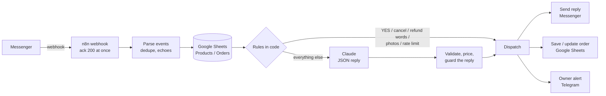

# Messenger Order Bot for Bangladeshi Facebook Shops

An AI sales assistant that answers customers in Facebook Messenger 24/7, takes Cash-on-Delivery orders, and writes them straight into the shop's Google Sheet, in English or Bangla.

Built with **n8n**, **Claude (Anthropic API)**, **Google Sheets**, **Telegram** and the **Meta Messenger Platform**.

> Most Bangladeshi online shops sell through Facebook pages, and every order still starts as an inbox message that a person has to answer by hand. Late-night questions go unanswered, prices get typed wrong, and fake COD orders waste delivery charges. This bot handles the repetitive 80% and hands the rest to a human.

---

## What it does

| | |
|---|---|
| 💬 **Answers product questions** | Price, stock, colours, warranty and delivery charge, as a neat product card |
| 🧾 **Takes orders** | Collects name, number, address and note; shows a priced summary with the return policy; saves the order after the customer taps **YES** |
| ❌ **Handles cancellations** | Customers can cancel within a set time window (the Sheet row updates and the shop owner is alerted); after that, a polite apology |
| 🙋 **Hands over to a human** | Refunds, complaints, bulk orders or "talk to a person" pause the bot and alert the owner on Telegram |
| 🛡️ **Flags risky COD orders** | High-value or repeat-return customers are marked for advance payment or review |
| 🌐 **Speaks the customer's language** | Bangla script for Bangla, clear English for Banglish/English, addressing customers as "Sir/Ma'am" |

### A real conversation

```
Customer: Hi
Bot:      Assalamu Alaikum Sir/Ma'am 🌸 Welcome to TechNest BD!
          📌 All prices are fixed
          🚚 Delivery: Inside Dhaka ৳70 | Outside Dhaka ৳130
          💵 Cash on Delivery available
          Which product are you looking for? Please share the product Name/Code or an image 😊

Customer: smart watch er dam koto?
Bot:      📦 Smart Watch Fit Pro
          💰 Price: ৳2,990
          🎨 Colors: Black, Silver
          ✅ In stock
          🛡️ Warranty: 6 months
          🚚 Delivery: Inside Dhaka ৳70 | Outside Dhaka ৳130

          For order please share the following details Sir/Ma'am 👇
          Name:
          Number:
          Address:
          Note (If any):

Customer: Silver ta nibo. Name: Nusrat, Number: 01XXXXXXXXX, Address: House 7 Road 3 Dhanmondi, Dhaka
Bot:      🛍️ Your order summary Sir/Ma'am:
          📦 Smart Watch Fit Pro (Silver) × 1 = ৳2,990
          💰 Products: ৳2,990
          🚚 Delivery charge (inside Dhaka): ৳70
          ━━━━━━━━━━
          💵 Total: ৳3,060 (Cash on Delivery)
          ...
          📌 Return policy: ...
          If everything is correct, reply "YES" to confirm Sir/Ma'am ✅

Customer: YES ✅
Bot:      ✅ Your order has been received Sir/Ma'am!
          🧾 Order ID: ORD-261024-0001
          📞 Our team will call you shortly to confirm.
          ❌ To cancel, just type "cancel" within 2 hours.
```

---

## Architecture



**The one design rule:** the AI talks; code handles the money.
Claude only chats and extracts details as strict JSON. Prices, totals, delivery charges, stock checks, phone validation, COD risk, order IDs and the "order confirmed" message are all deterministic code, so a model mistake can never change what a customer pays.

---

## How I built it

1. **Market research first.** I researched how 40–50 of the biggest Bangladeshi Facebook shops actually take orders (inbox, COD, courier booking) to find the most repeated manual work. Inbox order-taking came out on top.
2. **Prompt + deterministic core.** I wrote the system prompt (tone, hard rules, handover rules, strict JSON output) and a shared code library for validation, pricing, risk and message templates.
3. **Workflow as code.** The n8n workflow (23 nodes) is generated from source files by a build script, so every change is reviewable in Git instead of being clicked together by hand.
4. **Tested like a QA engineer.** A small n8n executor runs the *real* workflow JSON (the real node code, expressions and wiring) with Meta, Claude, Sheets and Telegram stubbed. It covers 43 scenarios: pricing, invalid phones, out-of-stock, bulk orders, prompt injection, duplicate webhooks, API failures, cancellations and more.
5. **Live on a test Page.** Meta app, webhook, Google Sheet and Telegram connected, then manual end-to-end runs (order → Sheet → alert → cancel).
6. **Iterated on real feedback.** Tone went from heavy Banglish → shop-style "apu" → professional "Sir/Ma'am" English, plus an order form, return policy and a cancellation window, all requested after reading real shop chats.
7. **Verified deployments.** Each update was applied to the live workflow and checked by hashing the deployed code against the tested build, so what runs is exactly what passed the tests.

---

## What I learned

- **Never let the LLM do arithmetic or make promises.** Pricing and confirmations in code, plus guards that block any reply containing a price not in the catalog or a claim that an order is "confirmed", made the bot safe to put in front of real customers.
- **Models copy their examples.** After switching the greeting to "Sir/Ma'am", the bot kept saying "apu" because the prompt examples did. The examples had to use the same placeholders as the rules.
- **Language is a product decision.** "Write in Banglish" produced awkward grammar ("Kon color nibo?" instead of *niben*). Clear English for Banglish writers and Bangla for Bangla-script writers read far more professionally.
- **Small platform details break real systems:**
  - n8n refuses to run a webhook that responds immediately when the workflow also contains a "Respond to Webhook" node.
  - Google Sheets silently drops the leading 0 from phone numbers unless the column is plain text.
  - Meta only delivers messages from people with a role on the app until App Review is passed.
- **Idempotency matters.** Meta can deliver the same webhook twice, so every message ID is de-duplicated, and cancellations update the existing row (append-or-update on `order_id`) instead of adding a new one.
- **Hand over early.** A bot that knows when to step aside (refunds, complaints, photos, bulk orders) earns more trust than one that tries to answer everything.

---

## Tech stack


**Numbers:** 23-node workflow · 43 automated test scenarios · replies within seconds · estimated ৳0.04–0.07 of AI cost per reply (Claude Haiku with prompt caching)

---

## Roadmap

- [ ] Meta App Review so the bot can serve real customers on client Pages
- [ ] Automatic stock deduction on confirmed orders
- [ ] Courier booking (Steadfast / Pathao) and a fraud check before dispatch
- [ ] Webhook signature verification
- [ ] One multi-shop workflow driven by a settings sheet

---

## About this repository

This is a public case study. The source code (workflow, prompt, tests) is kept in a private repository because the bot is offered commercially to shops. Happy to walk through it or demo it live: reach me on [LinkedIn](https://www.linkedin.com/in/shiary/).
